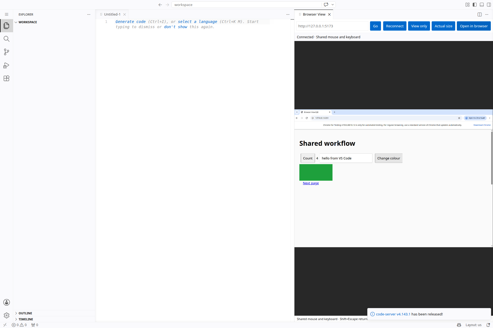

# Browser View

Use one Chromium browser with your coding agent, inside VS Code or code-server.
You see the same tabs, form values and clicks. The browser keeps running when you
close the panel, and your profile survives restarts.

The panel streams a Linux desktop through the editor's extension connection. It
works without an iframe login workaround or a public VNC port.

[Download the latest VSIX](https://github.com/samuel-zhang01/browser-view/releases/latest)
· [Setup and troubleshooting](docs/TROUBLESHOOTING.md)
· [Audit and test coverage](VALIDATION.md)
· [Report a bug](https://github.com/samuel-zhang01/browser-view/issues/new/choose)



## Supported setups

| Editor | Where the browser runs | Installation |
| --- | --- | --- |
| VS Code on Linux | Local Linux machine | Install the VSIX locally |
| VS Code on Windows/macOS/Linux with Remote SSH | Remote Linux host | Install the VSIX on the SSH host |
| VS Code with WSL | Linux distribution in WSL | Install the VSIX in WSL |
| code-server | Linux host running code-server | Install the VSIX in code-server |

The extension host needs **Linux, Python 3.10+, Node.js 22+, Chromium/Chrome,
Xvfb, xauth, x11vnc and websockify**. A desktop environment is not needed.
Native Windows/macOS hosting and browser-only vscode.dev are not supported.
Remote SSH and WSL use the same Linux runtime; see validation for paths actually
exercised in this release.

## Install

1. On the **Linux extension host**, install Node.js 22 or newer and Python 3,
   then the display tools. On Debian/Ubuntu:

   ```bash
   sudo apt-get update
   sudo apt-get install xvfb xauth x11vnc websockify
   node --version
   python3 --version
   ```

2. Install a current system Chromium or Google Chrome. Alternatively, clone the
   source and let the optional setup script download Playwright's Chromium
   after you build the package (see below).

3. Download `browser-view-0.3.0.vsix` from the
   [v0.3.0 release](https://github.com/samuel-zhang01/browser-view/releases/tag/v0.3.0).
   In the editor, run **Extensions: Install from VSIX…** and select it. When
   using Remote SSH/WSL, choose the Linux remote extension host.

   Command-line alternatives:

   ```bash
   code --install-extension ./browser-view-0.3.0.vsix --force
   # Or, on the code-server host:
   code-server --install-extension ./browser-view-0.3.0.vsix --force
   ```

4. Open a trusted workspace. Run **Browser View: Open Shared Browser** from the
   Command Palette. On upgrades, first run **Developer: Reload Window** in each
   open editor window.

The VSIX includes the runtime and Playwright Core. Opening the panel needs no npm
install, agent subscription or Codex skill. Releases are downloadable VSIX files;
this project is not currently listed in Marketplace or Open VSX. The extension
ID remains `local-tools.shared-browser` so existing local installs upgrade
without duplicate commands.

**Root containers:** prefer a non-root host with Chromium's sandbox enabled.
An isolated root container requires the explicit machine setting
`"browserView.allowNoSandbox": true`. This turns off Chromium's sandbox; it is not
appropriate isolation for hostile browsing.

## Everyday use

Start your app server separately, then enter its URL in **Page URL**, for example
`http://127.0.0.1:5173`. `localhost:5173` also works. Localhost refers to the Linux
host where Chromium runs. The toolbar navigates the first normal browser tab and
brings it to the front; use Chromium's own tabs/address bar for other tabs.

- **Actual size** toggles between fitting the desktop into the panel and showing
  full-size text with scrollbars. It changes only this viewer.
- **View only** blocks input from this panel. The agent and other viewers retain
  control. Take turns typing when input is shared.
- **Shift+Escape** moves keyboard focus from the canvas to the toolbar. Then use
  editor shortcuts normally. Chromium also has its own keyboard shortcuts.
- **Reconnect** refreshes the display connection and retains tabs and form data.
- **Open in browser** opens a second viewer, useful on another monitor. In
  code-server it uses the configured port proxy. In Remote SSH, VS Code forwards
  the loopback viewer port. Keep forwarding private.
- Closing or hiding a panel stops its stream. Chromium continues running.
- **Browser View: Stop Shared Browser** stops the session for all viewers and
  agents. It keeps the browser profile. Reopen to start it again.
- **Browser View: Diagnostics** shows the loaded extension version and safe
  runtime metadata. It does not print cookies or page contents.

The desktop size stays stable as you resize panels or move between monitors;
viewers do not fight over the page layout. Use two editor windows or a panel plus
an external viewer for separate screens. For a larger desktop, change the size
settings below, stop the session, and reopen it. This is one virtual monitor,
not an extended multi-monitor OS desktop.

The canvas cannot expose the remote page's accessibility tree to your local
screen reader. Toolbar controls are labeled and keyboard accessible. Touch and
narrow layouts are supported, but a keyboard and a larger screen are more useful
for sustained editing. Audio and automatic clipboard sharing are not provided.

## Configuration

Use editor user/remote machine settings. Stop the browser **before** changing
state directory, ports or display; reopen afterward. Changing quality/compression
takes effect when you reconnect the viewer.

| Setting | Default | Purpose |
| --- | --- | --- |
| `browserView.desktopWidth` | `1440` | Desktop width, 640–3840 pixels |
| `browserView.desktopHeight` | `1000` | Desktop height, 480–2160 pixels |
| `browserView.quality` | `6` | JPEG quality, 0–9 |
| `browserView.compression` | `2` | Compression, 0–9; higher uses more CPU |
| `browserView.webPort` | `6080` | Private loopback viewer port |
| `browserView.cdpPort` | `9222` | Private agent-control port; never publish |
| `browserView.display` | `98` | Dedicated virtual X display number |
| `browserView.stateDirectory` | empty | Defaults to `~/.local/share/browser-view` |
| `browserView.chromiumPath` | empty | Discover a system or Playwright browser |
| `browserView.allowNoSandbox` | `false` | Explicit exception for isolated root hosts |

For example, a 1080p desktop:

```json
{
  "browserView.desktopWidth": 1920,
  "browserView.desktopHeight": 1080
}
```

Environment overrides take precedence for test isolation: `BROWSER_VIEW_STATE`,
`BROWSER_VIEW_WEB_PORT`, `BROWSER_VIEW_CDP_PORT`, `BROWSER_VIEW_DISPLAY`,
`BROWSER_VIEW_WIDTH`, `BROWSER_VIEW_HEIGHT`, and `BROWSER_VIEW_CHROMIUM`.
The editor always takes its sandbox decision from `browserView.allowNoSandbox`.

## Optional agent CLI and skill

To build and install from source, including the optional agent skill:

```bash
git clone https://github.com/samuel-zhang01/browser-view.git
cd browser-view
npm ci
npm run package
./scripts/setup.sh --editor code-server   # Or --editor code
```

The setup script installs the built VSIX, copies the skill, and downloads
Playwright Chromium if no browser is found. It does not run sudo. For an isolated
root host, add `--allow-no-sandbox` to persist the CLI exception and separately
set the editor's machine setting described above.

Add `~/.local/bin` to PATH, then:

```bash
browser-view start                 # Reuse the current page
browser-view tabs                  # List tabs before choosing one
browser-view goto http://127.0.0.1:5173
browser-view screenshot /tmp/page.png
browser-view snapshot
browser-view button 'Save'
browser-view type 'Example text'
browser-view key Tab
browser-view status
```

The optional `browser-view` skill describes shared control for agents. The CLI
uses Playwright/CDP; it is not a native computer-use tool. Set
`BROWSER_VIEW_TAB_URL` to an exact existing URL to target a particular tab.
`browser-view start URL` deliberately navigates the first tab. Screenshot
coordinates cover page content, whereas panel coordinates include browser chrome.

CLI settings live in `~/.config/browser-view/settings.json` and use the short names
from the table, such as `desktopWidth`, `webPort`, `stateDirectory` and
`allowNoSandbox`. Match custom editor settings there or through environment
variables so agents attach to the same session. `BROWSER_VIEW_EXTENSION` selects
an explicit extension installation, including custom extension directories.

## Security and development

Read [SECURITY.md](SECURITY.md) before exposing a host to other users. Profiles,
logs and authentication state belong outside the repository. Keep code-server
login and TLS verification enabled. VNC uses a private Unix socket; Xvfb requires
an authority cookie; CDP and the external viewer bind only to loopback. The
webview transports bounded binary messages through the editor connection.

```bash
npm ci
npm test
npm run package
npm run test:e2e
npm audit
```

E2E tests use a clean, isolated editor profile, browser profile, display and
ports. Set `BROWSER_VIEW_CODE_SERVER` to the standalone code-server executable
when needed. For a native Linux VS Code run:

```bash
BROWSER_VIEW_VSCODE=/path/to/VSCode-linux-x64/code \
  xvfb-run -a -s '-screen 0 2560x1600x24 -nolisten tcp' npm run test:e2e
```

Do not run the two E2E modes concurrently: their fixture ports are intentionally
fixed. [VALIDATION.md](VALIDATION.md) records the checks and remaining coverage
gaps. [docs/AUDIT.md](docs/AUDIT.md) explains the fixes and upstream issues.
Original code is MIT; bundled noVNC is MPL-2.0 and Playwright Core is Apache-2.0.
Keep [THIRD_PARTY_NOTICES.md](THIRD_PARTY_NOTICES.md) and the bundled license files.
